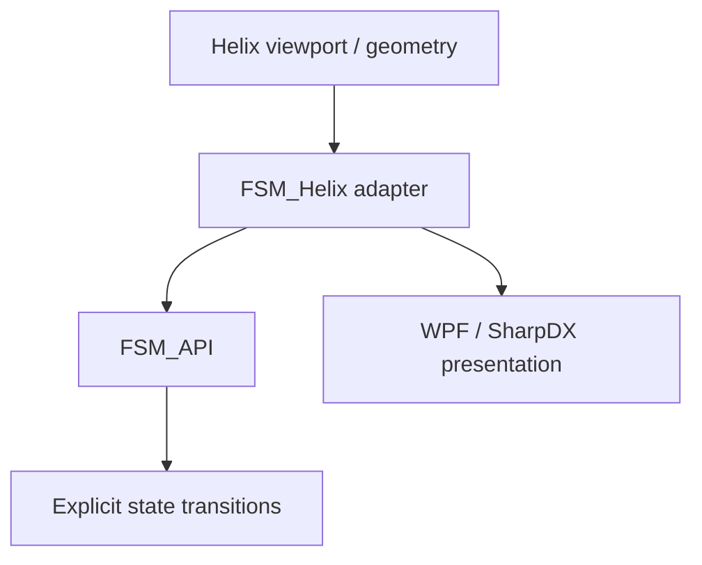

# ✳️ 00 The Singularity Workshop — FSM_Helix

### A state-driven bridge between FSM_API and the Helix Toolkit

> **A preserved chapter in the Workshop's rendering history—not a current rendering-engine recommendation.**

FSM_Helix explored wrapping Helix Toolkit's WPF/SharpDX viewport and geometry objects with finite-state-machine behavior. The experiment remains useful as an example of applying explicit state boundaries to a rendering adapter, even though the Workshop has moved on from both this rendering path and Unity.

## 🟦 01 What

FSM_Helix connects FSM_API state contexts and behaviors to selected Helix Toolkit 3D objects, including mesh, line, and viewport wrappers.

## 🟣 02 Why

Rendering integrations accumulate lifecycle, visibility, camera, and interaction concerns. This project explored separating those concerns into named state behaviors rather than letting them disappear into one large collection of event handlers.

## 🔺 03 How

The adapter wraps Helix objects; FSM_API provides the state-machine machinery. Helix and WPF remain external presentation dependencies.

## 🟢 04 See it in a minute

This repository currently preserves the source and its animated Workshop identity. It is **not a supported, release-targeted renderer**. Build requirements and compatibility should be checked before attempting to use it in a new application; no current Workshop project should take a dependency on this adapter by default.

## 🟪 05 Documentation and theory

- [Source code](FSM_Bridge.Helix/)
- [Project file](FSM_Bridge.Helix/FSM_Helix.csproj)
- [FSM_API](https://github.com/TrentBest/FSM_API)
- [The Singularity Workshop](https://github.com/TrentBest)

---

**Status:** historical / experimental adapter. Development-branch maintenance may improve build hygiene and documentation, but there is no planned NuGet release. The current Workshop's renderer and GUI projects are the forward path.

[MIT License](LICENSE.txt)

---

   
  <strong>The Singularity Workshop</strong> 
  <em>If a picture is worth a thousand words, what is a living picture worth?</em> 
  <a href="https://github.com/TrentBest">GitHub</a> · <a href="https://www.patreon.com/TheSingularityWorkshop">Support the Workshop</a>

