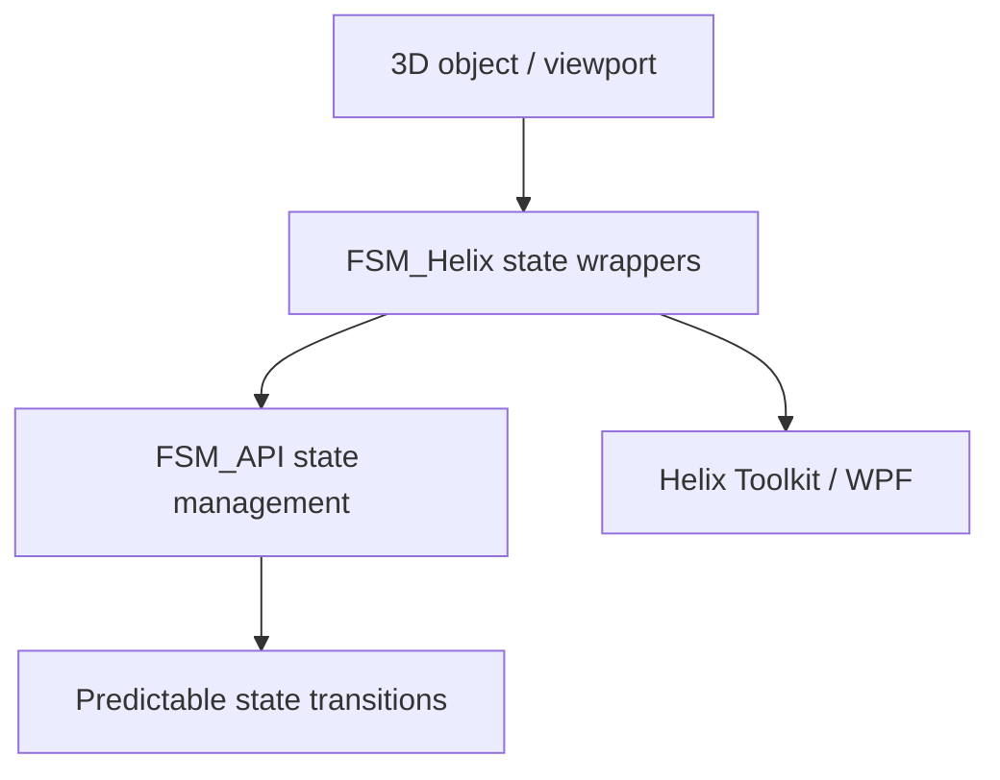

# ✳️ 00 The Singularity Workshop — FSM_Helix

### **A State-Driven Abstraction for the Helix Toolkit** 💥
> **A state-driven bridge between FSM_API and Helix Toolkit-based 3D/WPF applications.**

This package provides FSM wrappers for managing the state of 3D objects and viewport behavior. It is a bridge package, not a replacement for either FSM_API or the Helix Toolkit.



## 🟦 01 What

FSM_Helix connects finite-state-machine behavior to Helix Toolkit objects so stateful 3D presentation can be managed through explicit FSM wrappers.

## 🟣 02 Why

Complex viewports combine concerns such as lifecycle, camera control, and rendering. Explicit FSM boundaries let those concerns be managed independently rather than hidden in a single collection of event handlers.

## 🔺 03 How

Use the wrappers around the relevant Helix Toolkit objects, keep state transitions in FSM_API, and let the WPF/Helix layer remain responsible for presentation. The existing examples below describe the repository's concrete integration surface.

## 🟢 04 See it in a minute

Start with the Getting Started section below, then build the project against its documented Helix Toolkit and FSM_API dependencies.

## 🟪 05 Documentation and theory

[Getting Started](#getting-started) · [Architectural Philosophy](#architectural-philosophy) · [Dependencies](#dependencies) · [License](#license)

---

## Detailed guide

Welcome to **FSM\_Helix**—the architectural bridge between the powerful [Helix Toolkit](https://github.com/helix-toolkit/helix-toolkit) and the robust [FSM\_API](https://github.com/TrentBest/FSM_API) state management framework. This library is a testament to the principle that **"state shouldn't be a mess."** It provides a clean, predictable, and performant way to manage the state of 3D objects and rendering in a WPF application.

Instead of directly interacting with complex `HelixToolkit` objects, you'll use our FSM wrappers to control their behavior. This approach ensures that every aspect of your 3D scene, from a single mesh's visibility to the entire viewport's rendering pipeline, is governed by a well-defined and predictable FSM.

### **Core Features**

  * **Compositional State Management:** We decompose complex objects like a `Viewport3DX` into multiple, orthogonal FSMs. This means you can manage a viewport's `Lifecycle`, `CameraControl`, and `Rendering` states independently.
  * **Performance by Design:** FSMs that are not in an active state (e.g., a camera in a `Static` state) can have their processing suspended, ensuring that your application only spends resources on what is currently happening.
  * **A Unified API:** The `HelixStateContext` abstract class provides a consistent blueprint for all our FSM wrappers, giving developers a uniform way to interact with any component in the `FSM_Helix` library.
  * **Seamless Integration:** Designed for WPF, this library allows you to embed a `Viewport3DX` in your XAML and then control its entire state from a central, FSM-driven C\# backend.

### **Getting Started**

1.  **Add `FSM_Helix` to your project.**
2.  **Add a `<h:Viewport3DX>` to your XAML.**
3.  **Instantiate the FSM wrapper** in your code-behind. This creates the entire compositional FSM hierarchy for you.

<!-- end list -->

```csharp
// In your MainWindow.xaml.cs
public partial class MainWindow : Window
{
    private HelixViewport3DX_FSM _viewportFSM;

    public MainWindow()
    {
        InitializeComponent();
        
        // This single line creates a powerful, state-driven viewport.
        _viewportFSM = new HelixViewport3DX_FSM(MainViewport);
        
        // To suspend rendering when a UI panel is open:
        // _viewportFSM.Behaviors["Rendering"].TransitionTo("Suspended");
    }
}
```

### **Architectural Philosophy**

This library is a foundational stepping stone for building scalable 3D applications. It leverages the FSM-driven P2P architecture described in our main project, [GitHackforFun](https://www.google.com/search?q=https://github.com/TrentBest/GitHackforFun), by allowing game clients to confidently manage their local state while knowing that all changes will be handled through a robust, predictable FSM.

### **Dependencies**

This project relies on the following NuGet packages:

  * [HelixToolkit.Wpf.SharpDX](https://www.nuget.org/packages/HelixToolkit.Wpf.SharpDX)
  * [TheSingularityWorkshop.FSM\_API](https://www.nuget.org/packages/TheSingularityWorkshop.FSM_API)

### **License**

This project is licensed under the **MIT License**.